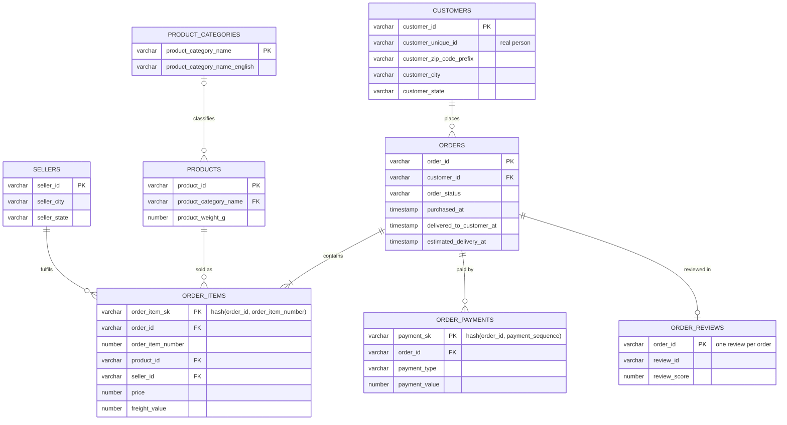
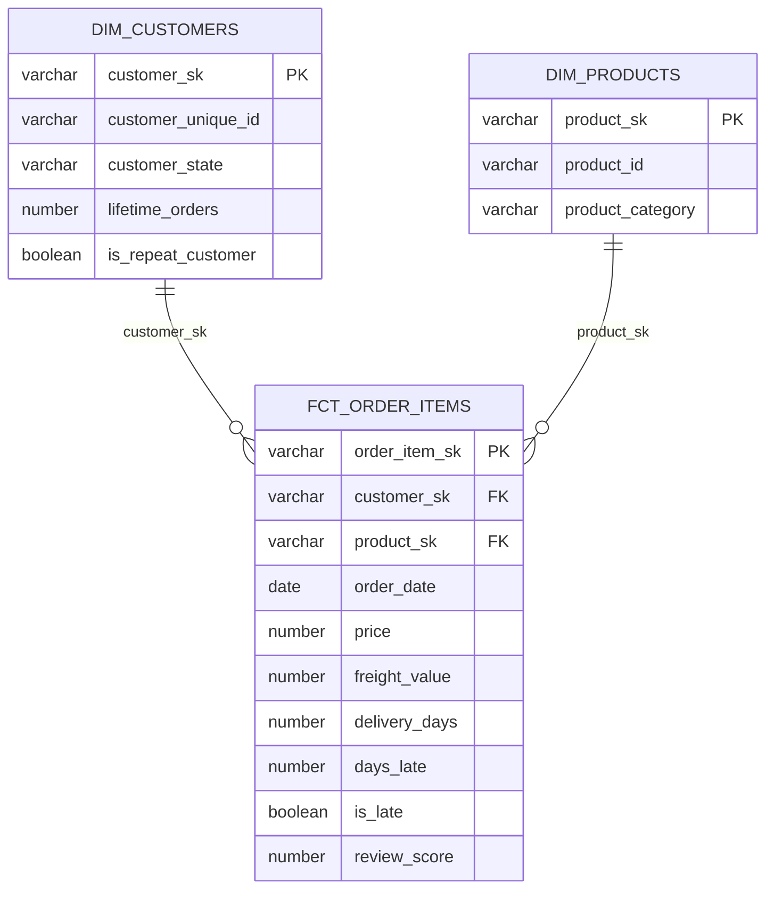

# Data model

## 1. Normalised model (staging layer, 3NF)

**Normalisation reasoning.** Each entity holds facts about one thing only, keyed by its own identifier, and every foreign key is tested with dbt `relationships` tests because Snowflake does not enforce constraints. The main many-to-many relationships, orders ↔ products and orders ↔ sellers, are resolved by `ORDER_ITEMS`, a bridge table with a composite key (order_id + item number) hashed into a single surrogate key. Payments are a separate one-to-many table because one order can be split across several payment methods. I deliberately break 3NF in two places: city and state stay on customers and sellers instead of a separate postcode table, because the geolocation file has several cities per postcode prefix and isn't needed for the analysis; and reviews are reduced to one per order (latest kept), because `review_id` is not unique in the source and the business question is "how did the customer rate this order?".

## 2. Star schema (marts layer)

**Why normalise in staging and denormalise in marts.** Staging is normalised so each fact lives in one place and stays consistent and testable. Marts are a star schema so analysts answer business questions with one simple join, without needing to know the source model.

## 3. Key strategy, types and materialisation

| Topic | Approach |
|---|---|
| Keys | Natural keys where unique (order_id, product_id); `dbt_utils.generate_surrogate_key` (MD5 hash) for composite keys and all mart keys |
| Duplicates | Every staging model keeps one row per key with `QUALIFY ROW_NUMBER() OVER (PARTITION BY key ORDER BY _loaded_at DESC) = 1` |
| Proving keys | `unique` + `not_null` on every key, `relationships` on every foreign key (43 tests, all passing) |
| Types | Raw = VARCHAR (lossless landing); staging casts with `TRY_TO_TIMESTAMP_NTZ` / `TRY_TO_NUMBER(…, 10, 2)` so bad values become NULL instead of failing; postcodes stay text to keep leading zeros |
| Materialisation | Raw = tables (COPY INTO); staging = **views** (always fresh, no storage, only read by marts); marts = **tables** (fast for analysts). At larger scale `fct_order_items` would become **incremental** |
| Grain | dim_customers = real person (`customer_unique_id`); fct_order_items = one item sold; reviews = one per order |